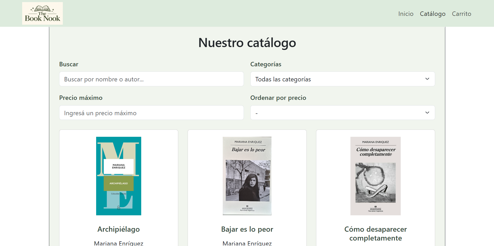
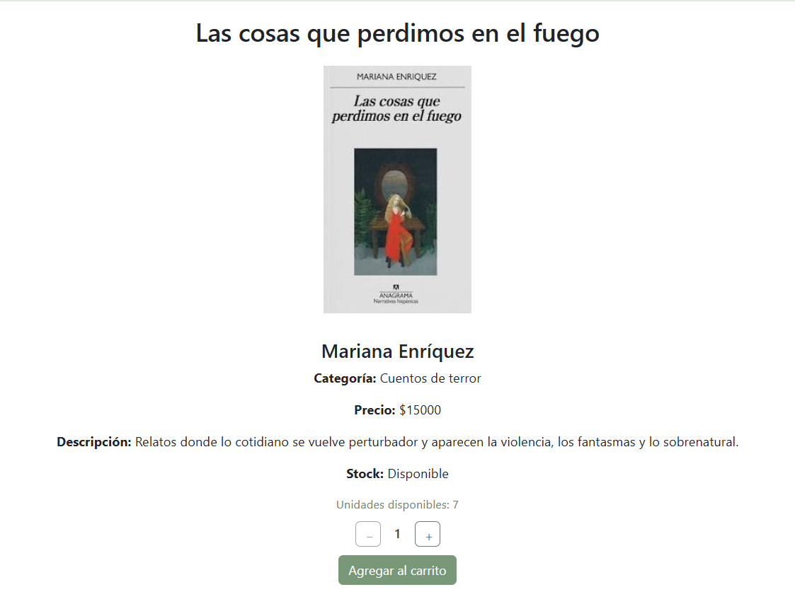
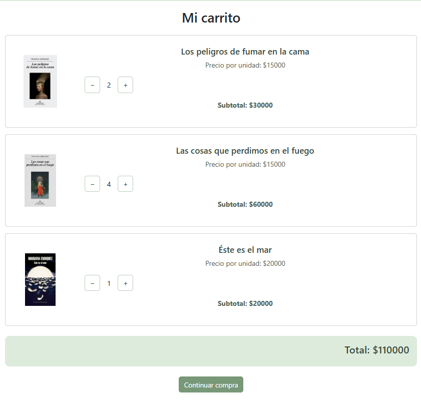

# The Book Nook 📚

## Descripción

The Book Nook es una tienda online de libros desarrollada como proyecto académico. Su objetivo es ofrecer una experiencia de compra sencilla e intuitiva, permitiendo explorar un catálogo de libros, consultar sus detalles y gestionar un carrito de compras.

## Tecnologías utilizadas

- **React:** desarrollo de la interfaz de usuario.
- **JavaScript:** lenguaje de programación.
- **Vite:** herramienta de desarrollo y compilación.
- **React Bootstrap:** componentes y estilos de interfaz.
- **React Router DOM:** navegación entre páginas.
- **Context API:** gestión global del carrito de compras.
- **Hooks de React:** `useState`, `useEffect` y `useContext`.

## Funcionalidades

- Página de inicio con presentación de la tienda y banners.
- Catálogo de libros.
- Visualización del detalle de cada libro.
- Carrito de compras con posibilidad de agregar y quitar unidades.
- Control de stock disponible.
- Cálculo automático de subtotales y total de compra.
- Formulario de compra con validaciones.
- Notificaciones al agregar productos al carrito.

## Instalación y ejecución

Para ejecutar el proyecto localmente, seguir estos pasos:

1. Clonar el repositorio:

   ```bash
   git clone URL_DEL_REPOSITORIO
   ```

2. Ingresar a la carpeta del proyecto:

   ```bash
   cd the-book-nook
   ```


3. Instalar las dependencias:

   ```bash
   npm install
   ```

4. Iniciar el servidor de desarrollo:

   ```bash
   npm run dev
   ```

5. Abrir en el navegador la dirección local que indique Vite.

## Integrantes

- Nombre y apellido: [Camila Montalbano]


## Capturas de pantalla

### Página de inicio


### Catálogo



### Detalle del libro



### Carrito de compras

